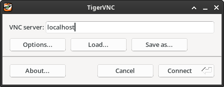

Title: [pt-BR] Materiais da Jornada Tecnológica 2026 da UNIP Araraquara
Date: 2026-09-25 23:00
Category: Teaching


No dia 25/09/2026, apresentei a palestra "Linux Faça Você Mesmo: Um Guia Prático de Desenvolvimento de Kernel com QEMU e Arch Linux" na Jornada Tecnológica da UNIP Araraquara, evento universitário voltado aos alunos dos cursos de Ciência da Computação e Análise e Desenvolvimento de Sistemas da universidade e à comunidade.

Abaixo, encontram-se os slides e o estudo dirigido da palestra.

### Slides

Os slides da palestra estão disponíveis <a href="../files/linux-faca-voce-mesmo.pdf" target="_blank">aqui</a>.

**ERRATA: no slide 53, onde se lê: "`ssh-server`", leia-se: "`openssh`".**

### Estudo dirigido

<s>Aguarde. O estudo dirigido será postado aqui até o dia 02/10/2026!</s>

Com o devido pedido de desculpas pelo atraso, a 09/10/2026, ei-lo:

**Introdução**

Este estudo dirigido provê ao leitor subsídios para iniciar o seu próprio processo de aprendizado sobre desenvolvimento de kernel Linux, com foco na preparação de um ambiente de desenvolvimento virtualizado utilizando QEMU e Arch Linux.

Ao finalizar o roteiro aqui apresentado, espera-se que o leitor seja capaz de:

1. Configurar o seu próprio ambiente virtualizado de desenvolvimento de kernel Linux;
2. Compilar e instalar o seu próprio kernel em uma máquina virtual Arch Linux;
3. Iniciar--se assim desejar--a própria jornada profissional e/ou acadêmica em desenvolvimento de kernel Linux, munido do conhecimento prático inicial aqui contido, bem como de referências externas para aprofundamento e continuidade de seus próprios estudos.

Longe de prover _hand-holding_, este guia revisita--com maior profundidade--os passos do processo de setup de ambiente de desenvolvimento apresentados na palestra supracitada, a saber: _Preparação do host físico_, _Instalação do QEMU_, _Criação de uma VM no QEMU e instalação do Arch Linux_, _Instalação e configuração do SSH server na VM_ e _Compilação e instalação do kernel Linux na VM_.

> Dica: mantenha as suas próprias notas da execução dos passos abaixo. Isso vai facilitar futuras iterações de setup.

**Preparação do host físico**

Como mencionei na palestra, você não precisa de uma "super máquina" para compilar o kernel Linux, mas alguns atributos podem tornar a sua experiência de compilação com o setup aqui proposto menos frustrante. Com base em minha experiência pessoal, para um setup sustentável no longo prazo, eu sugeriria que você reservasse:

- Pelo menos 48 GiB de armazenamento, a serem alocados para o disco virtual da sua VM;
- Pelo menos 12 GiB de memória RAM, a serem alocados para a sua VM--i.e. em adição à memória utilizada pelo sistema operacional (SO) do seu host físico;
- Pelo menos 6 cores que possam ser alocados para a sua VM--i.e. em adição aos cores utilizados pelo SO do seu host físico.

Repito: essas são apenas _recomendações pessoais_. Somente através da _experimentação_ é possível determinar o que funciona _para você_, com base nos recursos computacionais que _você tem_. Não se permita desanimar caso os recursos que você tem disponíveis estejam, em alguma medida, abaixo dos supracitados. É perfeitamente possível trabalhar com menos!

Outro aspecto a levar em consideração é o SO do seu host físico. Eu sugeriria fortemente que você optasse por trabalhar com Linux. O meu principal argumento para isso é que usar Linux como o seu SO principal--i.e. seu _daily driver_--vai forçá-lo a aprender muito mais sobre o SO que você está se propondo a programar do que se você utilizar qualquer outro sistema operacional--mesmo se ele for de base Unix, como o MacOS.

Se esta _não_ for a sua primeira experiência com Linux e você já se sentir confortável com Linux como _daily driver_, sinta-se à vontade para economizar tempo e seguir para a próxima seção deste estudo dirigido (_Instalação do QEMU_, imediatamente após as reticências abaixo).

Por outro lado, se esta for a sua primeira experiência com Linux, eu recomendaria fortemente que você começasse por uma distribuição (distro) considerada _main stream_, como o <a href="https://www.linuxmint.com/" target="_blank">Linux Mint</a>, por exemplo. De novo, essa é apenas a _minha opinião_. Não deixe de conhecer <a href="https://distrowatch.com/" target="_blank">as principais distros Linux</a> e os pontos fortes e fracos de cada uma antes de escolher uma que pareça fazer sentido _para você_. Além disso, não deixe de ponderar a respeito do tipo de setup que você deseja ter. Por exemplo, talvez você não queira Linux como o seu _único_ SO por enquanto, optando por um setup dual boot. Faça a sua própria pesquisa e tire as suas próprias conclusões. O <a href="https://www.youtube.com/@Diolinux" target="_blank">canal Diolinux no YouTube</a> é um excelente ponto de partida.

> **EXERCÍCIO: procure conhecer sobre as principais distros Linux disponíveis, encontre uma que pareça fazer sentido _para você_, aprenda a instalá-la e configurá-la, faça dela o seu _daily driver_ durante alguns meses e só siga para a próxima seção deste estudo dirigido quando você estiver se sentindo confortável com Linux, incluindo usar o terminal para realizar tarefas do dia a dia. Até daqui a alguns meses...**

.

.

.

.

.

.

.

.

.

Se você seguiu o enunciado do exercício anterior, bem-vindo de volta! Eu espero que os últimos meses tenham sido muito enriquecedores! A seguir, continuamos com a instalação do QEMU no seu host físico Linux, com o qual você já deve estar bastante familiarizado.

**Instalação do QEMU**

Neste estudo dirigido, eu sugiro a utilização do QEMU como software de virtualização. Combinado com o uso de <a href="https://en.wikipedia.org/wiki/Kernel-based_Virtual_Machine" target="_blank">KVM</a> em hosts Linux, o QEMU é capaz de atingir performance quase nativa em VMs, o que torna o seu uso extremamente vantajoso. Entretanto, sinta-se livre para explorar o uso de outro software de virtualização se você desejar. Uma alternativa, também open source, é o <a href="https://www.virtualbox.org/" target="_blank">VirtualBox</a>.

Se você ainda não compreende o conceito de virtualização, leia <a href="https://en.wikipedia.org/wiki/Virtualization" target="_blank">a página da Wikipédia</a> sobre esse assunto.

A instalação do QEMU depende da distro que você escolheu na seção anterior deste estudo dirigido, mas utilizando o gerenciador de pacotes padrão da sua distro, o procedimento certamente é bastante simples. Cabe a você descobrir como instalá-lo em sua distro escolhida.

No Arch Linux (a distro que eu uso), <a href="https://wiki.archlinux.org/title/QEMU" target="_blank">a instalação do pacote base--sem GUI--do QEMU</a> pode ser feita com:

```bash
sudo pacman -S qemu-base
```

Uma vez que você tenha instalado o QEMU, invocar algo como `qemu-img --version` a partir do terminal deve produzir uma saída como:

```bash
qemu-img version 11.0.1
Copyright (c) 2003-2026 Fabrice Bellard and the QEMU Project developers
```

> **EXERCÍCIOS:**
>
> **1. Entenda de maneira introdutória o que significa "_virtualização_"--você não precisa se tornar um _expert_: os conceitos introdutórios bastam;**
>
> **2. Descubra como instalar o QEMU na sua distro escolhida e execute o procedimento de instalação.**

**Criação de uma VM no QEMU e instalação do Arch Linux**

Instalado o QEMU, o próximo passo é baixar a imagem de instalação do SO do seu host de compilação. Neste estudo dirigido, eu sugiro o Arch Linux. O arguemnto objetivo para isso é que como o Arch permite um grau de personalização muito grande, é possível instalar apenas o que for estritamente necessário para atingir os seus objetivos de desenvolvimento do kernel. Entretanto--como tudo neste estudo dirigido--, caso você esteja preparado para menos _hand-holding_, sinta-se livre para--e encorajado a--explorar SOs alternativos para o seu host de compilação. Uma opção bastante comum é o <a href="https://ubuntu.com/download" target="_blank">Ubuntu Linux</a>.

Note que, se você optar pelo Ubuntu Linux como SO do seu host de compilação, talvez você queira considerar o uso da versão Ubuntu Server.

Dito isso, o download da imagem de instalação oficial do Arch Linux pode ser feito a partir da <a href="https://archlinux.org/download/" target="_blank">página oficial de downloads da distro</a>. Caso você esteja em Araraquara-SP, talvez você queira optar por utilizar o mirror da UFSCar, em São Carlos-SP:


Baixada a imagem de instalação, o próximo passo é criar a VM do seu host de compilação. A criação de uma VM no QEMU se inicia pelo provisionamento de um disco virtual. O comando abaixo cria um disco virtual de 48 GiB em `arch.qcow2`. Adapte-o conforme as suas preferências pessoais:

```bash
qemu-img create -f qcow2 arch.qcow2 48G
```

O próximo passo é iniciar a sua VM pela primeira vez para realizar a instalação do SO do seu host de compilação. Adapte o comando abaixo conforme o nome do arquivo da imagem que você baixou e, ainda, conforme as suas preferências pessoais em relação aos recursos a serem alocados para a VM. Observe que o comando abaixo especifica o provisionamento de 12 GiB de memória RAM--com `-m 12G`--e de 6 cores--com `-smp 6`--, e você pode querer alterar esses valores de acordo com os recursos computacionais à sua disposição:

```bash
qemu-system-x86_64 -enable-kvm -cdrom archlinux-2026.10.01-x86_64.iso -boot order=d -drive file=arch.qcow2,format=qcow2 -m 12G -smp 6
```

Quando o QEMU iniciar, ele vai apresentar uma saída parecida com:

```bash
VNC server running on ::1:5900
```

Isso significa que o QEMU está expondo um terminal de acesso à sua VM através de um protocolo de acesso remoto chamado <a href="https://en.wikipedia.org/wiki/VNC" target="_blank">VNC</a>. Para acessá-lo, você deve utilizar um cliente VNC, como o <a href="https://tigervnc.org/" target="_blank">TigerVNC</a>, por exemplo. No Arch Linux, o TigerVNC pode ser instalado com:

```bash
sudo pacman -S tigervnc
```

Se você estiver utilizando uma distro diferente do Arch Linux no seu host físico, busque o procedimento de instalação do TigerVNC adequado para ela ou, ainda, busque um cliente VNC alternativo que esteja disponível para a sua distro.

Uma vez instalado, você poderá utilizar o TigerVNC para acessar a VM do seu host de compilação com:

```bash
vncviewer localhost:5900
```

Observe que, caso a porta que o QEMU está expondo no seu host físico seja diferente da 5900, o comando acima deverá ser adaptado de acordo com a porta de VNC exposta.

Feito isso, você verá a seguinte janela:



Clique em _Connect_. Em seguida, instale o Arch Linux no seu host de compilação, procurando seguir os seguintes parâmetros de particionamento:

- 4 GiB para a partição `/boot`;
- 4 GiB para a partição de swap.

Caso você não saiba o que as instruções acima significam, será necessário entender o que significa particionar um disco antes. Leia a <a href="https://en.wikipedia.org/wiki/Disk_partitioning" target="_blank">página da Wikipédia sobre esse assunto</a> para construir intuição sobre o que isso significa.

Ademais, a minha recomendação é que você opte pela instalação `minimal` do Arch, pelos motivos já discutidos no início desta seção.

Aqui, cabe destacar que, até hoje--inexplicavelmente--, realizar a instalação do Arch Linux é um assunto considerado complexo. Muitos usuários de Arch Linux apreciam a "mística" que existe em torno desse assunto, porque ela os faz parecer mais espertos, mas a grande verdade é que, atualmente, não há nada de intrinsecamente difícil em realizar a instalação e a configuração inicial do Arch. Com um pouco de paciência e consulta às fontes de documentação certas--e <a href="https://wiki.archlinux.org/title/Main_page" target="_blank">o Arch é uma das distros Linux mais bem documentadas</a>, senão _a_ distro Linux mais bem documentada--, esse processo pode ser realizado de maneira relativamente simples. O canal Diolinux no YouTube já gravou diversos vídeos sobre esse assunto, sendo o mais recente quando da publicação deste estudo dirigido <a href="https://youtu.be/4BdnvhgltNo" target="_blank">o vídeo de 22 de julho de 2025</a>.

> **EXERCÍCIOS:**
>
> **1. Baixe a imagem de instalação do Arch Linux a partir da página oficial de downloads da distro;**
>
> **2. Crie uma máquina virtual no QEMU, respeitando os recursos computacionais disponíveis no seu host físico;**
>
> **3. Aprenda o que é e como realizar o particionamento de um disco, se você já não souber;**
>
> **4. Assista ao <a href="https://youtu.be/4BdnvhgltNo" target="_blank">vídeo mais recente do Diolinux</a> sobre instalação do Arch Linux;**
>
> **5. Instale o Arch Linux (`minimal`) na sua VM do QEMU, levando em consideração o particionamento supracitado.**

**Instalação e configuração do SSH server na VM**

Se você chegou até aqui, é provável que você tenha conseguido instalar e inicializar o Arch Linux na sua VM. Se você começou o estudo dirigido aqui contido como um iniciante completo em Linux e essa foi a sua primeira vez instalando o Arch, tire alguns segundos para apreciar o quão longe você já chegou.

Instalado o Arch na VM, o próximo passo é instalar e configurar um SSH server no host de compilação. Os motivos para isso foram discutidos na palestra, mas recapitulando, o SSH server permitirá acessar a sua VM através de SSH, facilitando o trabalho de desenvolvimento a ser realizado nela e permitindo, dentre outras coisas, o acesso remoto ao código que você clonar na sua VM a partir de ferramentas de desenvolvimento instaladas no seu host físico, como o emulador de terminal com o qual você já está habituado e o seu editor de texto favorito (o <a href="https://vscodium.com/" target="_blank">VSCodium</a>, por exemplo--ou o próprio Visual Studio Code, se você for usuário dos binários proprietários do editor--, oferece a funcionalidade de desenvolvimento remoto via SSH _out of the box_).

No Arch Linux, o SSH server <a href="https://wiki.archlinux.org/title/OpenSSH" target="_blank">é instalado pelo pacote do OpenSSH</a>. Para instalar o OpenSSH, basta executar:

```bash
sudo pacman -S openssh
```

Em seguida, é necessário configurar o SSH server do host de compilação para aceitar conexões via SSH a partir do seu host físico. Para fazer isso, basta editar `/etc/ssh/sshd_config` para configurar as opções:

```
Port 22
AddressFamily any
ListenAddress 0.0.0.0
ListenAddress ::
AllowUsers <usuário>
```

Onde `<usuário>` é o nome de usuário que você criou durante a instalação do SO da VM do host de compilação. Por fim, habilite o daemon do SSH server com:

```bash
sudo systemctl enable sshd.service
```

Isso vai fazer com que o SSH server inicie junto com o sistema. Agora, será necessário desligar a sua VM:

```bash
sudo shutdown now
```

E reiniciá-la (i) sem a imagem de instalação e (ii) expondo a porta 22 (SSH) para o host físico:

```bash
qemu-system-x86_64 -enable-kvm -boot order=d -drive file=arch.qcow2,format=qcow2 -m 12G -smp 6 -nic user,hostfwd=tcp::50022-:22
```

Note que, no comando acima, a porta 22 da VM do host de compilação foi redirecionada para a porta 50022 do host físico. Se tudo tiver corrido bem, depois que a VM iniciar e o SSH server estiver de pé, será possível acessar a VM do host de compilação via SSH a partir do seu host físico com:

```bash
ssh <usuário>@localhost -p 50022
```

Novamente, `<usuário>` é o usuário que você criou durante a instalação do SO da sua VM. Note que será necessário que um cliente SSH esteja instalado no seu host físico para que seja possível utilizar o comando `ssh`.

> **EXERCÍCIO: instale o SSH server na sua VM (host de compilação), procurando entender e reproduzir os passos descritos acima. Você não precisa se tornar um _expert_ em administração de SSH, mas é importante entender razoavelmente bem o que cada comando sugerido faz.**

**Instalação das dependências de compilação**

Configurado o acesso à VM do host de compilação via SSH, o próximo passo é instalar as dependências de compilação.

Como comentei na palestra, as dependências necessárias para compilar o kernel Linux são documentadas na página <a href="https://www.kernel.org/doc/html/latest/process/changes.html" target="_blank">Minimal requirements to compile the Kernel em kernel.org</a>.

Aqui, cabe destacar que há inúmeras diferenças entre distros Linux em relação a como dependências são empacotadas, o que significa que, caso você esteja utilizando uma distro diferente do Arch Linux no seu host de compilação, é possível que um conjunto de dependências diferente do aqui documentado precise ser instalado. Caso você tenha optado pelo Ubuntu Linux como SO do seu host de compilação, o conjunto de dependências a ser instalado é muito bem documentado no curso de desenvolvimento básico de kernel da Linux Foundation (referência no. 23 nos slides da palestra).

No Arch Linux, as dependências de compilação do kernel podem ser instaladas com:

```bash
sudo pacman -S base-devel git cscope ncurses openssl bison flex pahole jfsutils xfsprogs squashfs-tools btrfs-progs quota-tools ppp nfs-utils udev grub python3 bc python-sphinx ccache wget
```

Note que `ccache` e `wget` não são dependências de compilação documentadas, mas eu tomei a liberdade de adicioná-las à lista acima porque eu as considero muito úteis: conforme discutido em breve, `ccache` permitirá acelerar o processo de compilação do kernel usando caching, e `wget` é uma ferramenta bastante útil no geral para baixar recursos para o seu host de compilação diretamente a partir da Internet, sem a necessidade de copiá-los via SCP a partir do seu host físico.

Em seguida, no Arch Linux, é preciso criar um link simbólico em `/usr/bin/udevd` para `/lib/systemd/systemd-udevd`:

```bash
sudo ln -s /lib/systemd/systemd-udevd /usr/bin/udevd
```

Por fim, cabe mencionar que as dependências documentadas `pcmciautils` e `mcelog` são opcionais, necessárias apenas para determinados nichos de desenvolvimento do kernel. Tais dependências não são empacotadas para Arch Linux, sendo necessário empacotá-las e instalá-las manualmente você mesmo. Dito isso, fazê-lo _não é necessário_ para obter um setup de desenvolvimento de kernel genérico funcional. Caso você queira resolver absolutamente todas as dependências de compilação listadas na documentação--de novo, isso não é necessário para um setup de desenvolvimento de kernel genérico funcional--, você pode obter essas duas dependências faltantes a partir do AUR do Arch Linux, respectivamente, nos endereços:

- `pcmciautils`: <a href="https://aur.archlinux.org/packages/pcmciautils" target="_blank">https://aur.archlinux.org/packages/pcmciautils</a>
- `mcelog`: <a href="https://aur.archlinux.org/packages/mcelog" target="_blank">https://aur.archlinux.org/packages/mcelog</a>

E empacotá-las e instalá-las manualmente você mesmo. Tal processo foge ao escopo deste estudo dirigido e eu só o aconselharia a usuários proficientes de Arch Linux, mas ele é muito bem documentado <a href="https://wiki.archlinux.org/title/Arch_User_Repository" target="_blank">na Arch Wiki</a>.

Instaladas as dependências, você está pronto para clonar o repositório do kernel Linux. Navegue até o diretório onde você deseja cloná-lo e execute:

```bash
git clone git://git.kernel.org/pub/scm/linux/kernel/git/torvalds/linux.git --depth=1
```

Para clonar a árvore do próprio Linus. Note que a opção `--depth=1` permite que você faça o que se chama de "shallow clone", baixando apenas o código resultante do último commit feito ao repositório, sem a necessidade de baixar todo o histórico de commits.

> **EXERCÍCIO: siga os passos acima para instalar as dependências de compilação do kernel, adaptando-a às necessidades da sua distro escolhida, caso você tenha optado por uma distro diferente do Arch Linux para o SO do seu host de compilação. Em seguida, faça um shallow clone da árvore do Linus.**

**Compilação e instalação do kernel Linux na VM**

Chegamos ao último passo deste estudo dirigido. Tudo o que resta é compilar e instalar o kernel a partir do repositório clonado na seção anterior.

A essa altura, é uma boa ideia alterar a propriedade dos arquivos repositório para o seu usuário no host de compilação com:

```bash
chown -R $USER:$USER linux/
```

Isso evita eventuais problemas de permissionamento durante a compilação do kernel. O próximo passo é entrar no diretório do repositório com `cd linux/` e executar:

```bash
make mrproper
```

`mrproper` é um target do Makefile do kernel que limpa o repositório do projeto (analogamente a comandos `clean` de outros sistemas de build--de fato, incluindo o `make`).

Antes de invocar `make` novamente para iniciar com a compilação, é necessário criar um arquivo de configuração de compilação--arquivo `.config`--, conforme expliquei na palestra. Recapitulando esse assunto, esse arquivo contém variáveis que ativam e/ou desativam determinadas funcionalidades da base de código do kernel, adaptando o kernel compilado às necessidades do sistema no qual ele será instalado.

Existem várias maneiras de realizar a criação do arquivo `.config`, e uma das mais simples é copiar o arquivo de configuração de compilação do kernel usado para compilar o kernel da distro _já instalada no seu host de compilação_, replicando a configuração usada pelos desenvolvedores da própria distro. A vantagem disso é que já é sabido de antemão que essa configuração de kernel _é funcional_ para a sua VM.

No Arch Linux--e isso varia de distro para distro--, uma cópia do arquivo `.config` da distro fica salva em `/proc/config.gz`. Para obtê-la, basta copiar e descompactar o arquivo Gzip--i.e. (de dentro do repositório):

```bash
cp /proc/config.gz ./
gunzip config.gz
mv config .config
```

Obtido o arquivo `.config` da distro, é preciso ajustá-lo para levar em consideração eventuais adições às opções de configuração do kernel desde o momento em que o arquivo foi criado pelos desenvolvedores da distro até o momento em que os últimos commits foram feitos ao repositório clonado na seção anterior. Isso pode ser feito com:

```bash
yes "" | make oldconfig
```

O que o comando acima faz é invocar o target `oldconfig` do Makefile do kernel, que mescla o arquivo `.config` antigo com as eventuais adições às opções de configuração do kernel, gerando um novo arquivo `.config`. Feito isso, já é possível invocar o target de compilação do Makefile. Entretanto, eu gostaria de apresentar mais uma alternativa à geração do arquivo `.config` que pode ser útil em algumas situações.

O arquivo `.config` antigo obtido a partir da sua distro já é um bom ponto de partida para gerar um `.config` de compilação novo, mas é preciso lembrar que mesmo o `.config` da sua distro foi construído levando em consideração que o kernel resultante deveria estar preparado para funcionar em uma infinidade de máquinas diferentes, o que significa que nem todas as opções que ele habilita são necessárias à geração de um kernel funcional para a VM do seu host de compilação.

Sendo assim, caso a sua intenção seja compilar um kernel configurado especificamente para a sua VM durante o desenvolvimento, é possível minimizar a quantidade de opções de configuração habilitadas em `.config` verificando quais são os <a href="https://wiki.archlinux.org/title/Kernel_module" target="_blank">módulos de kernel</a> que, de fato, estão habilitados na sua VM, e gerando um arquivo `.config` habilitando _apenas_ as opções que permitem a utilização de tais módulos. Isso pode ser feito com:

```bash
lsmod > /tmp/local-lsmod
yes "" | make LSMOD=/tmp/local-lsmod localmodconfig
```

O que os comandos acima fazem é, respectivamente, criar uma lista dos módulos de kernel habilitados e salvá-la em `/tmp/local-lsmod` e, em seguida, criar o arquivo `.config` de compilação com base _apenas_ nos módulos habilitados. Isso economiza tempo de compilação em desenvolvimento, uma vez que somente as opções de configuração mínimas necessárias ao funcionamento correto do kernel na sua VM de desenvolvimento serão habilitadas no `.config` resultante.

Note que, se você estiver utilizando uma distro diferente do Arch Linux na VM do seu host de compilação, passos de configuração adicionais podem ser necessários. Em particular, se você estiver utilizando o Ubuntu Linux, você pode querer ler <a href="https://askubuntu.com/questions/1329538/compiling-kernel-5-11-11-and-later" target="_blank">esta thread do Stack Overflow</a>.

Sinta-se à vontade para escolher a opção de geração de `.config` mais adequada ao seu caso de uso, bem como para explorar as demais opções de geração de configuração de compilação disponíveis.

Finalmente, podemos invocar `make` para iniciar a compilação do kernel:

```bash
ccache make -j 7
```

No comando acima, adicionar `ccache` à invocação de `make` permite utilizar caching para acelerar compilações futuras, e eu recomendo fortemente o uso desse recurso. Ademais, `-j` sinaliza a quantidade de jobs que queremos utilizar durante a compilação. Aqui, o número 7 foi obtido somando 1 à quantidade de cores alocados para a VM (6). O motivo disso é procurar garantir que sempre haverá um job de compilação pronto para obter tempo de CPU quando algum outro job de compilação sofrer preempção. Existem diversas heurísticas para calcular a quantidade de cores a ser utilizada visando obter um bom desempenho de compilação, mas a minha experiência pessoal é que utilizar o número de cores alocados para VM + 1 entrega resultados bons o suficiente, pelo menos para o meu gosto. Sinta-se à vontade para experimentar com esse número e para se aprofundar nesse tópico. Entretanto, não exagere no número de jobs paralelos, pois há um limiar em que isso pode surtir o efeito oposto de _piorar_ o desempenho de compilação.

Iniciada a compilação, _vá fazer outra coisa_. Compilar o kernel, principalmente pela primeira vez, sem caching, pode demorar bastante...

.

.

.

.

.

.

.

.

.

Finalizada a compilação, você está pronto para seguir à instalação do kernel. Esse passo também pode ser diferente entre distros Linux, de forma que se você estiver utilizando uma distro diferente do Arch Linux na sua VM, pode ser necessário seguir um procedimento diferente do documentado abaixo.

Supondo que a sua VM é Arch Linux, o procedimento de instalação requer realizar a compilação e a instalação dos módulos de kernel com:

```bash
make modules
sudo make modules_install
```

Em seguida, você precisará copiar o binário compilado do kernel para a partição de boot da sua VM com:

```bash
sudo cp arch/x86/boot/bzImage /boot/vmlinuz-linux-<release string>
```

Onde `<release string>` é a tag de release do kernel compilado. A release string é configurada pelo `make` com base em valores especificados tanto no Makefile do kernel quanto no arquivo `.config`, e o valor consolidado pode ser obtido de `include/config/kernel.release` no repositório.

Por fim, é necessário gerar a imagem de initramfs--um filesystem mínimo e temporário, carregado pelo kernel em memória durante o boot do sistema e substituído pelo filesystem real em seguida, depois que ele é montado--e gerar uma nova configuração de GRUB, adicionando o novo kernel ao menu de boot do sistema:

```bash
sudo mkinitcpio -k <release string> -g /boot/initramfs-linux-<release string>.img
sudo grub-mkconfig -o /boot/grub/grub.cfg
```

Se você estiver usando o Ubuntu Linux na VM do seu host de compilação, os últimos passos descritos acima--geração do initramfs e de uma nova configuração de GRUB--devem ser substituídos por chamadas aos utilitários do Ubuntu:

```bash
sudo update-initramfs -c -k <release string>
sudo update-grub
```

Feito isso, você está pronto para reiniciar a VM. Se tudo tiver corrido bem, você será premiado com uma tela contendo um menu de GRUB, semelhante ao apresentado no slide 60 da palestra, em que você terá a opção de selecionar o novo kernel instalado.

> Dica: caso você tenha alguma dificuldade nessa etapa, no Arch Linux, uma possível medida de troubleshooting pode ser modificar algumas variáveis de configuração do GRUB em `/etc/default/grub`, aumentando o valor de `GRUB_TIMEOUT`--e.g. `GRUB_TIMEOUT=10`--, especificando `GRUB_TIMEOUT_STYLE=menu` e, ainda, adicionando `earlyprintk=vga` à lista de argumentos da variável `GRUB_CMDLINE_LINUX`.

> Dica: faça um backup do disco da sua VM. Isso vai facilitar futuras iterações de setup.

> **EXERCÍCIO: siga os passos acima para compilar e instalar o seu próprio kernel, adaptando-os às necessidades da sua distro escolhida, caso você tenha optado por uma distro diferente do Arch Linux para o SO do seu host de compilação.**

**Próximos passos**

Se você chegou até aqui, eu gostaria de lhe dar os meus parabéns. Você agora faz parte de um grupo bastante seleto. Somente uma porcentagem ínfima dos profissionais de computação já _compilou e instalou_ o seu próprio kernel Linux pelo menos uma vez na vida. Você agora é um desses profissionais, e isso _não é para qualquer um_.

No entanto, esse é apenas o começo da jornada. Somente uma porcentagem _mais ínfima ainda_ de profissionais de computação já _contribuiu_ com o kernel Linux e, se você chegou até aqui, eu só posso supor que _você tem essa vontade_. Se isso for verdade, eu fico muito feliz por você. O kernel Linux é uma base de código bastante complexa, e a jornada de disciplina, paciência, humildade e rigor técnico necessários para romper a barreira de ter a sua primeira contribuição aceita no kernel é _absurdamente_ enriquecedora. Portanto, _não desista_.

Dito isso, utilize as referências apresentadas na palestra para traçar a sua _própria_ estratégia de continuidade de estudos. Caso você já se sinta confortável com Linux e C, um passo natural é a realização do curso básico de desenvolvimento de kernel da Linux Foundation (referência no. 23 nos slides da palestra).

Outro possível passo natural--e um verdadeiro _construtor de caráter_--, é a realização do <a href="https://www.linuxfromscratch.org/" target="_blank">Linux From Scratch (LFS)</a>.

Qualquer que seja a sua estratégia pessoal, boa sorte nos estudos!

**Conclusão**

É isso.

Eu espero sinceramente que este estudo dirigido tenha sido útil para ajudar nos seus primeiros passos no desenvolvimento de kernel e que você se sinta, nesse momento, ainda mais motivado a continuar explorando, experimentando e aprendendo sobre esse universo em si mesmo que é o kernel Linux.

Não se engane: a jornada é longa e dura toda uma vida, mas cada pequeno aprendizado vale a pena, e eu espero que a cada um desses pequenos aprendizados que virão, conquistados a duras penas, a sua próxima linha de código seja sempre:

```c
//TODO keep going, it'll pay off
```

_Happy hacking._

_Edit: adicionar estudo dirigido._
_Edit: adicionar errata dos slides._